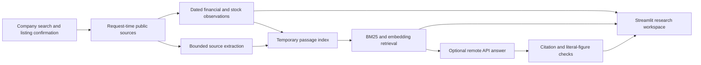

# EquityLens

**Company and stock research for Indian and US equities, with inspectable sources and session retrieval.**

[](https://github.com/shivatadha/equitylens/actions/workflows/verify.yml)


EquityLens turns a company lookup into a research workspace: market snapshots, daily prices, financial history, dated news, reported developments, source coverage, and questions over retrieved evidence. It distinguishes provider observations, official feed summaries, extracted passages, and unsupported claims so readers can inspect the basis for an answer.

**Status:** advanced portfolio prototype. The [hosted demo](https://equitylens-in.streamlit.app/) is online with an invitation-password gate. Hosted company search has shown a provider-access failure; complete research on Cloud is still being verified. Live sources have variable availability, and financial figures are not all independently reconciled.

[Architecture and measured results](docs/PORTFOLIO-CASE-STUDY.md) · [Deploy to Streamlit Cloud](docs/STREAMLIT-CLOUD.md) · [Configure API answers](docs/API-MODELS.md) · [Evaluation methodology](docs/EVALUATION.md)

## Features

| Area | What you can do |
| --- | --- |
| Company discovery | Search by company name or ticker, choose India or the United States, and confirm the listing. |
| Company overview | Inspect the latest available regular-session price, change, annual revenue, dated valuation inputs, and business context. |
| Daily charts | Explore 30D, 90D, 1Y, and 2Y windows. The default 30D view labels every available trading date. Hover for date, selected price, open, high, low, close, and volume. |
| Price context | View provider-adjusted historical performance, moving averages, observed volatility, drawdown, and dividend/split events when available. |
| Financial history | Compare annual observations, revenue growth, and operating margin. INR uses Indian digit grouping, crore, and lakh; USD remains in dollars. |
| News and developments | Browse dated headlines, reported projects, industry coverage, and exact-ticker NSE announcement summaries where available. |
| Evidence search | Search a temporary session index using BM25 and local embeddings, with fusion and diversity ranking. |
| Optional API answers | Ask questions over retrieved passages through Groq or another supported remote model API. Invalid citations and unsupported literal figures are filtered. |
| Source inspection | Open source links and expand original passages, evidence levels, and retrieval details. |
| Session controls | Research expires after 30 minutes by default and can be explicitly cleared. Reports stay in memory unless downloaded. |

The interface supports light and dark themes and responsive company, trading, news, and evidence cards. Weekends and market holidays do not receive invented stock observations.

## Architecture



The LangGraph workflow retrieves sources, extracts bounded content, chunks passages, and builds an expiring session index. Local embeddings use `BAAI/bge-small-en-v1.5`; answer generation uses an optional remote API. If embeddings are unavailable, the app labels retrieval as keyword-only.

FastAPI exposes the research service. Local development runs the API and UI as separate processes; `cloud_app.py` runs the existing API routes inside Streamlit for Community Cloud. PostgreSQL belongs to an archived milestone and is not required by the current flow.

## Run locally

Use Python 3.12. These commands use PowerShell on Windows.

```powershell
git clone https://github.com/shivatadha/equitylens.git
cd equitylens
py -3.12 -m venv .venv
.\.venv\Scripts\python.exe -m pip install -r requirements.lock.txt
Copy-Item .env.example .env
.\.venv\Scripts\python.exe scripts/setup_rag_model.py
```

The setup downloads general embedding weights. Company documents and vectors are not persisted to that model cache. Optional API keys belong in the local `.env`; see [API model setup](docs/API-MODELS.md). The current flow does not need the legacy database settings in the example file.

Start the API in one terminal:

```powershell
.\.venv\Scripts\python.exe -m equitylens.cli serve
```

Start the UI in a second terminal:

```powershell
.\.venv\Scripts\python.exe -m streamlit run ui.py --server.address 127.0.0.1
```

Open **http://127.0.0.1:8501**. The API schema is at **http://127.0.0.1:8001/docs**. On macOS or Linux, create the environment with `python3.12 -m venv .venv` and use `.venv/bin/python`.

Try searching for `Microsoft`, `Reliance`, or another covered equity. Confirm its listing, run research, inspect Stock & price, and ask about the retrieved evidence. API answers require a configured key and model; browsing and retrieval work without them.

If company-name search is unavailable, try an exact ticker such as `RELIANCE.NS` or `MSFT`. The app can verify it using fresh chart metadata when that endpoint remains available. It validates the symbol, exchange, instrument type, and company name before returning a match.

## Streamlit Community Cloud

1. Select this GitHub repository and **`cloud_app.py`** as the main file.
2. Choose **Python 3.12** in Advanced settings.
3. Add a long random **`EQUITYLENS_DEMO_PASSWORD`** through Cloud Secrets.
4. Add optional model settings through Cloud Secrets if you want generated answers.
5. Deploy and verify search, research, charts, retrieval, and a cited answer on the hosted URL.

The root `requirements.txt` supplies Cloud dependencies; `packages.txt` supplies the embedding runtime's Linux library. This deployment uses the embedded backend, so no separate FastAPI host or Docker Compose service is needed.

```toml
# Enter your own values in Cloud Secrets, never in Git.
EQUITYLENS_DEMO_PASSWORD = "replace-with-a-long-random-password"
LLM_API_KEY = "your-provider-key"
LLM_MODEL = "your-provider-model-id"
LLM_API_BASE_URL = "https://api.groq.com/openai/v1"
LLM_API_MODE = "chat_completions"
```

Only the demo password is required by the Cloud entrypoint. Model settings are optional. Keep `.env`, `.streamlit/secrets.toml`, keys, model caches, and local research data out of Git. Cloud restarts clear sessions; first-use model loading can be slow. See the [complete Cloud guide](docs/STREAMLIT-CLOUD.md).

## Data sources and limits

| Source | Current use and coverage |
| --- | --- |
| Yahoo Finance public endpoints | Lookup, stock history, and provider financial observations. Unofficial integration with no negotiated uptime guarantee. |
| Google News RSS | Dated headlines for news, projects, and industry discovery. A headline does not establish the contents of an unread article. |
| NSE public announcement RSS | Exact-ticker summaries and linked documents from a rolling feed; not a complete filing archive. |
| SEC companyfacts | Optional US annual 10-K facts, filing links, and matched-period amount comparisons. Requires a real contact in `SEC_USER_AGENT`, which is an identification string rather than an API key. |
| Optional providers | Tavily excerpts and EODHD profiles when configured. |

Quote time and research time are separate. Provider delays may be unknown. Indicative equity value combines a quote with dated ordinary shares and is labeled as an estimate. Financial period, currency, and reporting basis are retained; unavailable values remain unavailable.

Citation validation does not prove semantic support for every sentence. Indian official financial-statement reconciliation and a complete filing archive are not implemented. The answer audit is small; offline fixtures do not establish general financial accuracy. Hosted concurrency and sustained resource usage require further verification. The app does not establish investment suitability.

## Verification

The latest local run passed **177 tests**. CI runs Ruff, regression tests, and offline keyword-retrieval gates without provider keys. Tests cover source isolation, session expiry, financial formatting, chart bounds, daily hover details, model validation, and the Cloud invitation gate.

```powershell
.\.venv\Scripts\python.exe -m pytest -q
.\.venv\Scripts\python.exe -m ruff check .
.\.venv\Scripts\python.exe scripts/evaluate_retrieval.py --mode bm25 --min-all-relevant-at-5 0.8
.\.venv\Scripts\python.exe scripts/evaluate_retrieval.py --dataset evaluation/filing_pilot_2025.json --mode bm25 --min-all-relevant-at-5 1.0
```

[Evaluation notes](docs/EVALUATION.md) distinguish synthetic retrieval checks, a small filing pilot, and live audits. [The six-question live audit](docs/LIVE-ANSWER-AUDIT-2026-10-27.md) records successful answers and evidence gaps. Live smoke scripts make network requests; optional answer evaluations require explicit paid-API opt-in.

## Repository map

```text
cloud_app.py          Streamlit Community Cloud entrypoint
ui.py                 Streamlit research workspace
assets/               Shared styles and brand assets
equitylens/
  live/               Source adapters, stock calculations, retrieval, and workflow
  live_api.py         Research API routes
  embedded_client.py  In-process API client for Cloud
  presentation.py     Formatting and interactive charts
  overview_cards.py   Company and trading cards
  ui_cards.py         News and evidence cards
tests/                Regression tests and controlled provider responses
evaluation/           Frozen retrieval and answer-pilot fixtures
scripts/              Setup, smoke checks, and evaluation runners
docs/                 Architecture, deployment, evaluation, and source limits
.github/workflows/    Continuous verification
```

A stdio MCP server exposes lookup, research, session access, and evidence search. The earlier PostgreSQL library is preserved in `legacy_ui.py`, migrations, and the [archive documentation](docs/ARCHIVE-README.md); it is not the default app.

## Documentation

- [Portfolio case study](docs/PORTFOLIO-CASE-STUDY.md): architecture, measured results, and remaining proof points.
- [Streamlit Community Cloud](docs/STREAMLIT-CLOUD.md): deployment and Cloud Secrets.
- [API model configuration](docs/API-MODELS.md): Groq and other supported remote API protocols.
- [Session RAG](docs/SESSION-RAG.md): extraction, indexing, retrieval, and retention.
- [On-demand workflow](docs/ON-DEMAND.md): service behavior and live checks.
- [Evaluation](docs/EVALUATION.md): benchmark methodology and limits.
- [Hosted demo stack](docs/DEMO.md): Docker and reverse-proxy setup.
